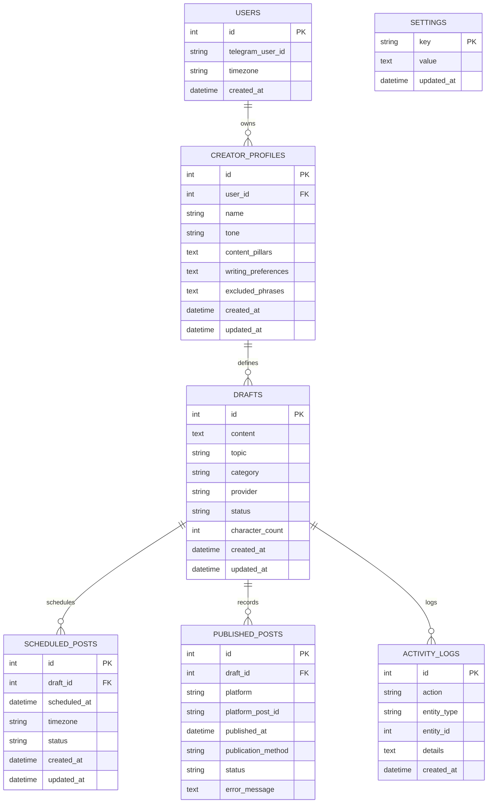
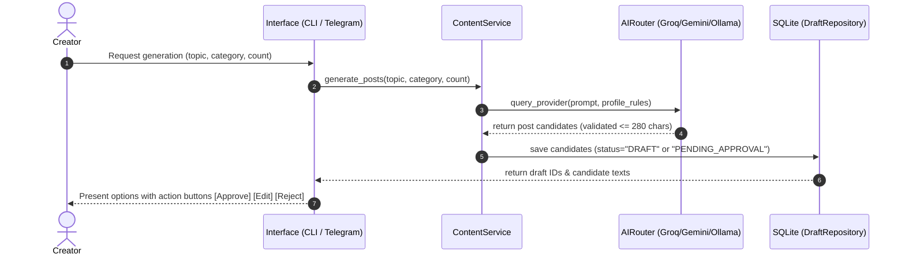
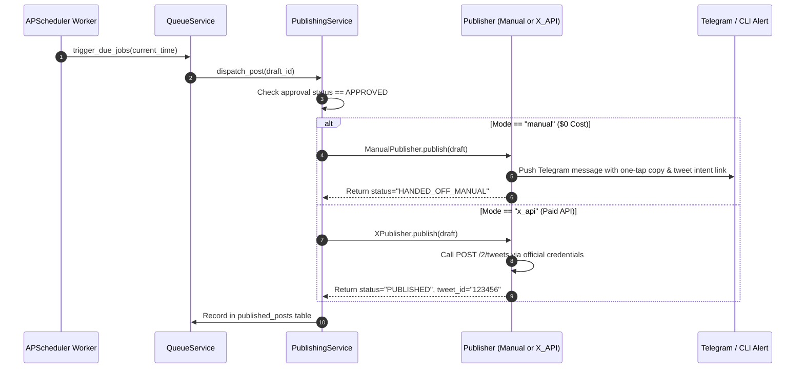

# PostPilot — System Architecture Document

**Architecture Pattern:** Clean / Layered Modular Architecture  
**Core Motto:** "One Engine, Multiple Interfaces."  
**Persisted Storage:** SQLite (Local-first, embedded, zero-config)  

---

## 1. High-Level Architectural Diagram

```
+-----------------------------------------------------------------------+
|                           INTERFACES                                  |
|                                                                       |
|   +-----------------------------+     +---------------------------+   |
|   |         Typer CLI           |     |    Telegram Bot Engine    |   |
|   |  (Rich UI, CLI commands,    |     |  (PTB Long-Polling, Auth, |   |
|   |   terminal notifications)   |     |   Inline Keyboards, Alerts)  |
|   +--------------+--------------+     +-------------+-------------+   |
+------------------|----------------------------------|-----------------+
                   |                                  |
                   +----------------+-----------------+
                                    |
+-----------------------------------v-----------------------------------+
|                        APPLICATION SERVICES                           |
|                                                                       |
|  +--------------------+  +--------------------+  +-----------------+  |
|  |   ContentService   |  |    DraftService    |  |   QueueService  |  |
|  +--------------------+  +--------------------+  +-----------------+  |
|  |  ApprovalService   |  |  SchedulingService |  | AutopilotEngine |  |
|  +--------------------+  +--------------------+  +-----------------+  |
|  |                     PublishingService                      |  |
|  +-----------------------------------------------------------------+  |
+-------------------|-------------------|-------------------|-----------+
                    |                   |                   |
    +---------------+                   |                   +---------------+
    |                                   |                                   |
+---v------------------+     +----------v---------+     +-------------------v---+
|       AI LAYER       |     |  PUBLISHING LAYER  |     |   DATA & SCHEDULER    |
|                      |     |                    |     |                       |
| +------------------+ |     | +----------------+ |     | +-------------------+ |
| |    AIRouter      | |     | | BasePublisher  | |     | |   APScheduler     | |
| +------------------+ |     | +--------+-------+ |     | | (SQLite JobStore) | |
| | Prompt Templates | |     |          |         |     | +-------------------+ |
| +------------------+ |     |    +-----+-----+   |     | | SQLAlchemy Repos  | |
| | Response Parser  | |     |    |           |   |     | +-------------------+ |
| +----+---+----+----+ |     | +--v----+ +----v-+ |     | |  SQLite Database  | |
|      |   |    |      |     | |Manual | |X API | |     | |   (postpilot.db)  | |
| +----v+ +v---+ +v--+ |     | |Adapter| | v2   | |     | +-------------------+ |
| |Groq | |Gem.| |Oll| |     | +-------+ +------+ |     +-----------------------+
| +-----+ +----+ +---+ |     +--------------------+
+----------------------+
```

---

## 2. Layer Responsibilities & Isolation Rules

### 2.1 Interface Layer (`src/postpilot/cli/` & `src/postpilot/telegram/`)
- **Boundary:** Interfaces **never** execute raw database queries, make raw AI API calls, or talk directly to the X API.
- **Role:** Parse inputs, enforce authentication (Telegram owner validation), present rich output (tables, boxes, inline buttons), and delegate directly to Application Services.

### 2.2 Application Services Layer (`src/postpilot/services/`)
- Orchestrates business workflows across repositories, AI routers, publishers, and the scheduler.
- **ContentService:** Formulates generation requests using Creator Profile context.
- **DraftService / QueueService:** Manages state transitions and queues.
- **ApprovalService:** Enforces permission checks before publishing.
- **SchedulingService:** Coordinates APScheduler jobs with SQLite records.
- **PublishingService:** Dispatches to the active publishing strategy (`manual` or `x_api`).

### 2.3 AI Layer (`src/postpilot/ai/`)
- **Provider-agnostic interface:**
  ```python
  class BaseAIProvider(ABC):
      @abstractmethod
      async def generate(self, prompt: str, system_prompt: str) -> list[str]: ...
      @abstractmethod
      async def test_connection(self) -> bool: ...
      @abstractmethod
      def get_model_name(self) -> str: ...
  ```
- **AIRouter:** Selects Groq (default, ultra-fast), Gemini (deep analysis), or Ollama (offline local) based on user preference or automatic fallback.
- **Validation:** Filters out posts exceeding 280 characters and rejects low-quality repeats.

### 2.4 Publishing Layer (`src/postpilot/publishers/`)
- Unified interface:
  ```python
  class BasePublisher(ABC):
      @abstractmethod
      async def publish(self, draft: Draft) -> PublishResult: ...
      @abstractmethod
      async def test_connection(self) -> bool: ...
  ```
- **ManualPublisher ($0):** Formats tweet text, prepares URL encode intents (`https://twitter.com/intent/tweet?text=...`), copies to clipboard (if CLI), and delivers ready-to-copy card in Telegram.
- **XPublisher:** Official X API v2 client using `httpx` with OAuth 1.0a / OAuth 2.0 PKCE. Handles rate limits (HTTP 429) and insufficient credit exceptions.

### 2.5 Data Layer (`src/postpilot/database/`)
- Powered by `SQLAlchemy` 2.0 with asynchronous and synchronous SQLite driver support.
- Encapsulated via the **Repository Pattern** (`DraftRepository`, `ScheduleRepository`, `SettingsRepository`, `LogsRepository`).

---

## 3. Database Schema (SQLite)



---

## 4. Sequence & Execution Flows

### 4.1 Content Generation & Approval Flow


### 4.2 Scheduled Execution: Dual Publishing ($0 Manual vs Official API)


---

## 5. Security & Compliance Architecture

1. **Local Secrets Isolation:** Secrets are read strictly from `.env` or system environment variables. Never logged in `activity_logs` or echoed in Telegram chat.
2. **Telegram Gatekeeper:** Any incoming Telegram update is matched against `TELEGRAM_OWNER_ID`. Unauthorized IDs are silently dropped and logged.
3. **Idempotent Job Dispatch:** When a scheduled post triggers, its state atomically transitions to `PUBLISHING` inside a database transaction to prevent concurrent duplicate tweets.
4. **Platform Compliance Guardrail:** Zero automated follows, likes, scraping, or headless web logins.
