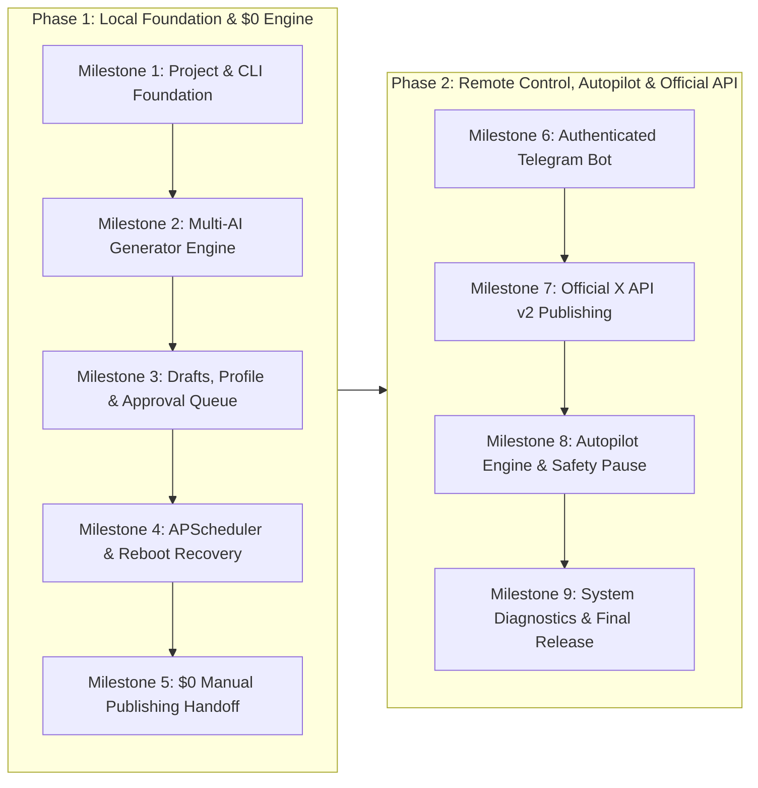

# PostPilot — Phased Development Flow

**Development Philosophy:** Build in two disciplined, test-verified phases.  
**North Star:** Phase 1 delivers a 100% operational, $0-cost personal content machine (CLI + Local Scheduler + Free AI + Manual Handoff). Phase 2 unlocks the Telegram interface, Autopilot, and the official X API.

---

## 2-Phase Overview Roadmap

---

## Phase 1: Core Engine, Local Drafts & $0 Manual Operations

> **Objective:** Deliver a fully functional command-line content workstation that generates, reviews, schedules, and dispatches tweets locally with zero spending.

### Milestone 1: Foundation, CLI & Database Architecture
- [ ] Initialize Python project using `pyproject.toml` with dependencies: `typer`, `rich`, `sqlalchemy`, `pydantic-settings`, `python-dotenv`.
- [ ] Configure SQLite database engine with asynchronous/synchronous support.
- [ ] Implement database models: `users`, `creator_profiles`, `drafts`, `scheduled_posts`, `published_posts`, `settings`, `activity_logs`.
- [ ] Build `postpilot init` to prompt for creator name, timezone (default `Africa/Lagos`), and set up configuration directory.
- [ ] Build `postpilot status` to display system health, provider readiness, and queue status.

### Milestone 2: Multi-Provider AI Generation Engine
- [ ] Abstract provider interface `BaseAIProvider` with unified signature.
- [ ] Implement **GroqProvider** (using `groq` SDK or `httpx` with fast Llama 3 models).
- [ ] Implement **GeminiProvider** (using Google Gemini free API tier).
- [ ] Implement **OllamaProvider** (local fallback at `http://localhost:11434`).
- [ ] Build `AIRouter` with auto-failover and model selection.
- [ ] Define modular prompt templates: Educational, Contrarian, Developer Observations, Technical Tips, Build-in-Public, Short Stories.
- [ ] Build post validator (strict $\le 280$ characters, hook variety, avoid buzzwords).
- [ ] Expose `postpilot generate --topic "..." --count 5 --category "..."`.

### Milestone 3: Content Management, Creator Profile & Approval State Machine
- [ ] Implement `CreatorProfile` configuration (tone, banned words, pillars).
- [ ] Implement `DraftRepository` and `DraftService`:
  - `postpilot drafts`: Interactive Rich table of drafts.
  - `postpilot draft view <id>`: Rich card view.
  - `postpilot edit <id>`: Modify text in default `$EDITOR` or inline.
  - `postpilot approve <id>`: Mark status as `APPROVED`.
  - `postpilot reject <id>`: Mark status as `CANCELLED`.
- [ ] Build Queue Manager: `postpilot queue` to inspect all pending posts ordered by target date.

### Milestone 4: Persistent Scheduling & Reboot Recovery
- [ ] Integrate `APScheduler` with SQLite job store.
- [ ] Timezone conversion utility based on user settings.
- [ ] State recovery logic: on `postpilot run` or scheduler startup, check for missed executions during machine sleep/reboots and prompt user.
- [ ] Implement commands:
  - `postpilot schedule <id> --at "YYYY-MM-DD HH:MM"`
  - `postpilot schedule list`
  - `postpilot schedule cancel <id>`
- [ ] Prevent duplicate job execution via database row-level locking / status checks.

### Milestone 5: $0 Manual Publishing Adapter
- [ ] Implement `ManualPublisher`:
  - Generates official Twitter Web Intent link: `https://twitter.com/intent/tweet?text=<encoded>`
  - Copies text directly to the system clipboard.
  - Displays formatted Rich box in terminal with one-click URL.
  - Records execution in `published_posts` with `publication_method = 'manual'`.
- [ ] Expose `postpilot publish <id>` and `postpilot run` (starts background scheduler loop).

---

## Phase 2: Remote Control, Autopilot & Official X API

> **Objective:** Add full remote management via Telegram, automated content creation/scheduling with Autopilot, and pay-per-use direct publishing via the official X API.

### Milestone 6: Telegram Bot Engine & Remote Queue Control
- [ ] Set up `python-telegram-bot` with long-polling (no public server/webhook needed).
- [ ] Enforce strict owner authentication (`security.py` checks `TELEGRAM_OWNER_ID`).
- [ ] Implement commands:
  - `/start`, `/help`, `/status`
  - `/generate`: Interactive conversational wizard (topic $\rightarrow$ category $\rightarrow$ count $\rightarrow$ candidates).
  - Inline keyboards for each draft: `[Approve]`, `[Edit]`, `[Regenerate]`, `[Schedule]`, `[Copy Text]`.
  - `/drafts` and `/queue` views.
  - Telegram alert push when a scheduled manual post is ready to publish (with instant copy code block).

### Milestone 7: Official X API v2 Publishing Integration
- [ ] Register OAuth credentials in `.env` (`X_CLIENT_ID`, `X_CLIENT_SECRET`, `X_ACCESS_TOKEN`, `X_ACCESS_TOKEN_SECRET`).
- [ ] Implement `XPublisher` using official endpoint `POST https://api.twitter.com/2/tweets`.
- [ ] Comprehensive error handling:
  - 401/403 (Invalid credentials or lack of permissions)
  - 429 (Rate limit reached $\rightarrow$ delay and retry)
  - Insufficient API credits $\rightarrow$ automatic graceful fallback to Manual Publishing mode with user alert.
- [ ] Store platform `tweet_id` and permalink upon successful publish.
- [ ] Command: `postpilot config set-publisher [manual|x_api]`.

### Milestone 8: Autopilot Engine & Safety Guardrails
- [ ] Configurable daily posting windows (e.g., 9:00 AM, 1:00 PM, 6:30 PM, 8:00 PM).
- [ ] Content pillar rotation logic (ensures variety across days).
- [ ] Distinct Autopilot Modes:
  - **Autopilot with Approval (Recommended):** Prepares drafts automatically and sends alerts to Telegram for review.
  - **Autonomous Autopilot:** Dispatches directly into queue only if explicitly unlocked.
- [ ] Safety Controls:
  - Daily post ceiling (`MAX_POSTS_PER_DAY = 3`).
  - Emergency Kill Switch: `postpilot autopilot disable` or Telegram `/pause`.

### Milestone 9: Diagnostics, System Verification & Release
- [ ] Implement `postpilot doctor` (diagnoses AI keys, DB connection, Telegram connection, X API credentials).
- [ ] Complete test suite execution (Unit, Integration, Mocks).
- [ ] Complete documentation, packaging, and setup guide.
